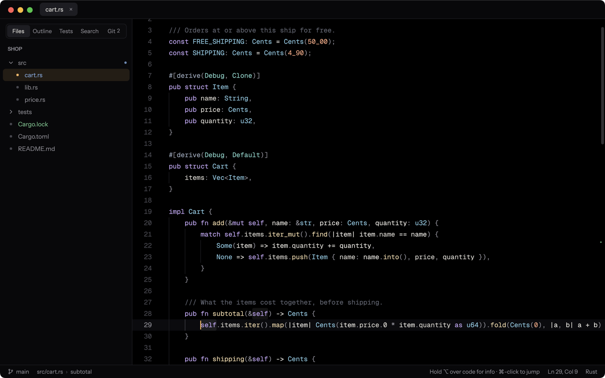
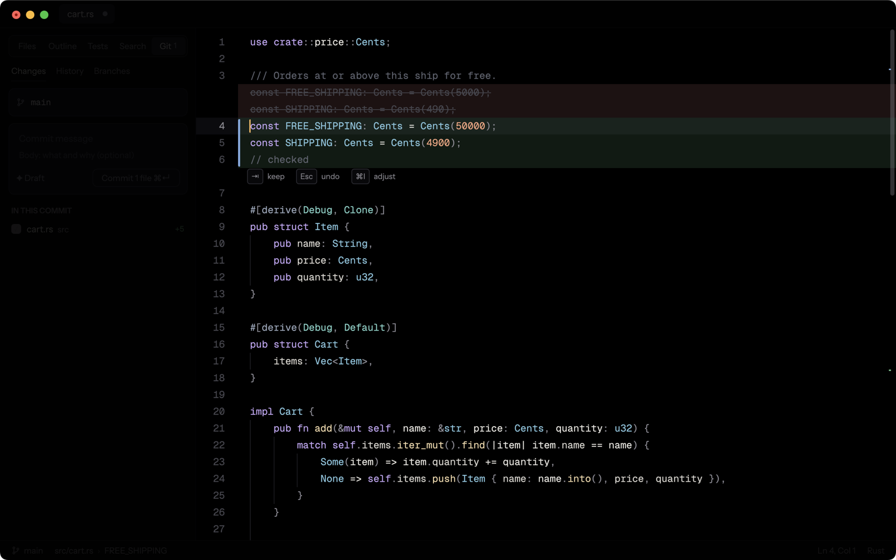
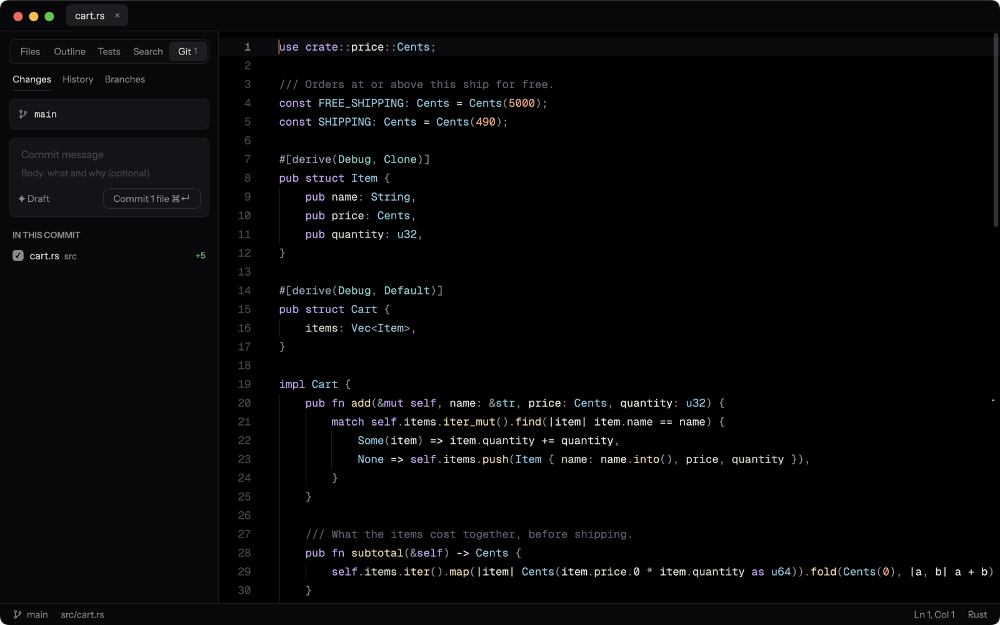
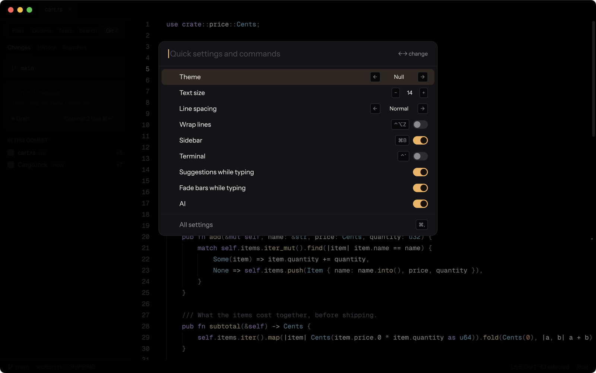

<h1 align="center">Null</h1>

<strong>A calm, fast code editor where nothing gets in your way.</strong>

  <a href="https://github.com/ShortPlanet3058/null-ide/releases/latest">Download</a> ·
  <a href="docs/guide.md">Guide</a> ·
  <a href="CHANGELOG.md">What's new</a>

Null is an editor built around one idea: the screen belongs to your code. No panels
competing for space, no badges asking for attention: the bars fade while you type and come
back when you look for them. Everything an IDE should do is there (language servers, git,
a terminal, tests, a debugger), a keystroke away and out of sight until then.

AI is a tool, not a co-pilot: hidden until you call it, never changing your code without
showing you the change, and nowhere at all when it's off.

## Why Null

- **Your code first.** One quiet window, a true-black theme that's easy on the eyes all day
  (and five others, light ones too), type set with care.
- **Fast.** Native and drawn on the GPU: it opens at once, big files included, and keeps up
  with your typing on a project of tens of thousands of files.
- **Everything, one keystroke away.** ⌘P goes to any file; ⌘K changes a setting or runs
  any command; menus and hints always name your keys.
- **AI when you ask.** Your Claude or ChatGPT plan, an API key (several are free), or a model
  on your own computer, or none at all.
- **Your hands already know it.** Keys from VS Code, JetBrains, Sublime Text or Zed, or Vim.

## What it does

<table>
<tr>
<td width="50%"></td>
<td width="50%"></td>
</tr>
<tr>
<td><strong>⌘I changes code where it is.</strong> Describe a change; it's written in as a diff
to keep with ⇥ or undo with Esc. Ask about a line and the answer sits under it.</td>
<td><strong>Git in one panel.</strong> Commit whole files or parts of them, see the history,
switch branches, resolve conflicts in place, review pull requests.</td>
</tr>
</table>

- **Code intelligence** for Rust, Python, TypeScript, Go, C and C++, Swift and more: the
  language server is found, or installed for you in one click.
- **Writing** that thinks ahead: multiple cursors, folding, rename everywhere, quick fixes,
  snippets, Emmet, and Markdown with a live preview, tables, formulas and diagrams.
- **Run, test and debug** without leaving the code: tasks, the test at the cursor, a
  terminal whose errors join the problems list, breakpoints with values shown in the code.
- **Never lose work**: unsaved changes survive a crash, every save is kept for a month, and
  files changed on disk are never silently written over.

## Download

Get the latest version from the [releases page](https://github.com/ShortPlanet3058/null-ide/releases/latest).

| | |
|---|---|
| **macOS** 11 or later, Intel and Apple silicon | Open the `.dmg` and drag Null to Applications. The first time, right-click Null and choose **Open**. |
| **Windows** 10 and 11 | Run the installer (`…-setup.exe`, no administrator needed): Null in the Start menu, `null` in your terminals, "Open with Null" on folders. Or unzip the `.zip` anywhere and run `null.exe`. |
| **Linux** x86-64, X11 or Wayland | Ubuntu and Debian: `sudo apt install ./null-linux-amd64.deb`. Elsewhere, unpack the `.tar.gz` and run `./install.sh` (Null in `~/.local/bin` and your applications menu). |

From a terminal, `null .` opens the folder you're in, `null src/main.rs:42` a file at a line,
and `null --wait` makes Null git's editor (on the Mac, and with the `.zip`, **Install Shell
Command** in ⌘K adds `null` first).

Null is young: used every day on the Mac, new on Windows and Linux. If something's wrong,
please [open an issue](https://github.com/ShortPlanet3058/null-ide/issues).

## First steps

| Mac | Windows / Linux | |
|---|---|---|
| ⌘P | Ctrl+P | Go to a file |
| ⌘K | Ctrl+K | Quick settings, and every command |
| ⌘⇧F | Ctrl+Shift+F | Search the project |
| ⌘I | Ctrl+I | Ask AI to change the code here (when it's on) |
| ⌃⇧G | Ctrl+Shift+G | The changes to commit |
| ⌘, | Ctrl+, | All settings |

The [guide](docs/guide.md) has everything else.

## Building it yourself

Null is written in Rust with [GPUI](https://github.com/zed-industries/zed/tree/main/crates/gpui).
With [Rust](https://rustup.rs) installed (and Xcode on the Mac), `cargo run` opens the folder
you're in. [CONTRIBUTING.md](CONTRIBUTING.md) has the rest: Linux's libraries, packages,
tests and how releases are made.

## License

Null is free and open source, under the [GNU General Public License 3.0](LICENSE): use it
for anything, and share it as you like; a changed Null you share must stay open under the
same license. Copyright © 2026 ShortPlanet3058. Its fonts are under the SIL Open Font
License (see `assets/fonts`).
